### Делаю сайты, которые быстро открываются и удобны на телефоне

Веб-разработчик: лендинги, многостраничные сайты и интернет-магазины. Верстаю с 2022 года:
работал с прямыми заказчиками, на подряде у веб-студии и в арбитражной команде.

**[Портфолио с живыми демо →](https://karelin-dev.github.io)** &nbsp;·&nbsp; **[Telegram: @karelin_dev](https://t.me/karelin_dev)**

<picture>
  <source media="(prefers-color-scheme: dark)" srcset="assets/ivan-dark.svg">
  
</picture>
